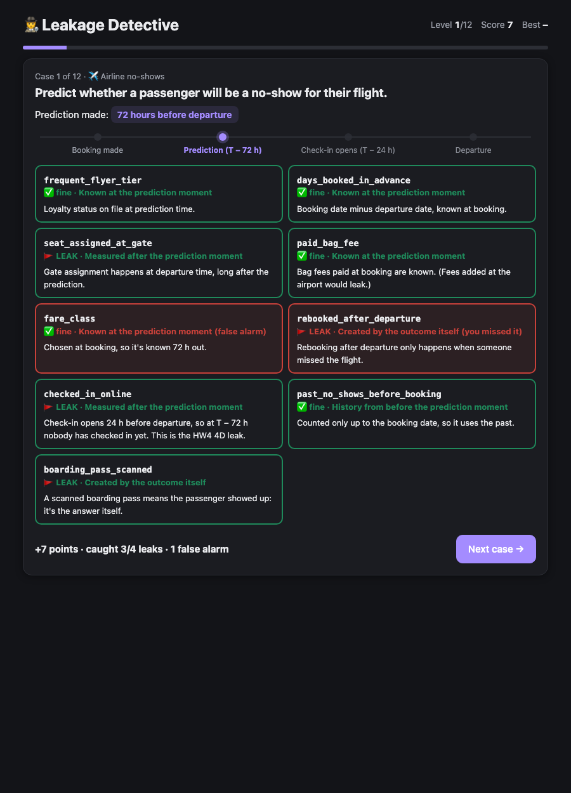
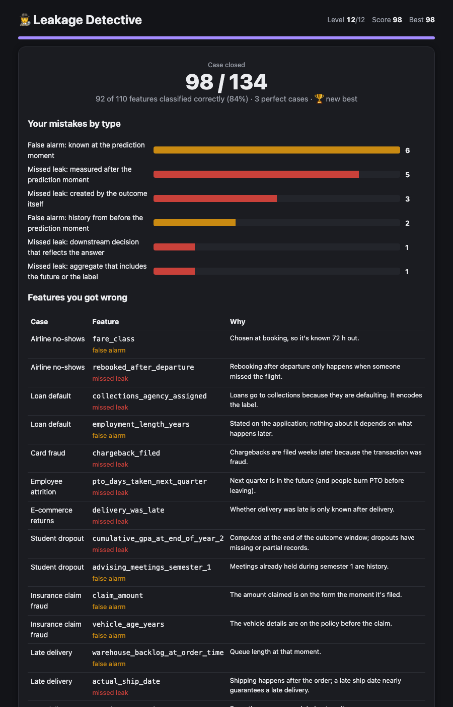

# Leakage Detective 🕵️

HW4 4D as a browser game. Each of **12 case files** shows a prediction task, **the exact moment the prediction is made** (on a timeline), and 9–10 features. You flag the ones that leak. After you submit, every feature is revealed with a one-line explanation. The final report groups your mistakes by type.

| A revealed case | The final report |
|---|---|
|  |  |

## Cases

Airline no-shows (with the HW4 `checked_in_online` leak), loan default, subscription churn, hospital readmission, card fraud, hotel cancellations, employee attrition, e-commerce returns, student dropout, insurance claim fraud, late delivery, and ad clicks. That's **110 features in all, 47 of them leaky.**

Every feature is labeled with one of six types:

| 🚩 Leaks | ✅ Fine |
|---|---|
| measured **after** the prediction moment | **known** at the prediction moment |
| created **by the outcome** itself (refund issued, exit interview) | **history** from before the prediction moment |
| **aggregates** that include the future or the label (lifetime totals, target encoding on all data) | |
| **downstream decisions** that already reflect the answer (sent to collections, fraud-team referral) | |

Some safe features are deliberately tempting. `deposit_type` predicts hotel cancellations strongly, but it's known at booking. Some leaks hide in "reasonable" names, like `ad_ctr_computed_on_full_dataset`.

## Scoring

- **Points:** +1 for each feature classified correctly (leaks flagged, safe ones left alone), +2 for a perfect case. The maximum is 134.
- **Best score:** kept in `localStorage`.
- **Final report:**
  - misses and false alarms by type, as a bar chart
  - a table of every feature you got wrong, with its explanation
  - a tip aimed at your most common slip

## Play

Open `index.html`. Feature order is shuffled each time. Demo URLs: `?demo=1&reveal=1` shows a revealed case, and `?demo=12` shows the final report.

## Tests

```
node test.mjs
```

There are 16 checks:
- **Content:**
  - 12 levels with 8–10 features each, and at least 3 leaks and 3 safe features per level
  - every leak flag consistent with its type, all six types used
  - every feature explained (25+ characters)
  - unique names and one marked prediction moment per level
  - leaks balanced at 43% of features, and the HW4 leak present
- **Scoring:** perfect, flag-nothing and flag-everything cases, and the maximum score.
- **Mistake summary:** counts, grouping and sorting are right, and shuffling keeps every feature.
